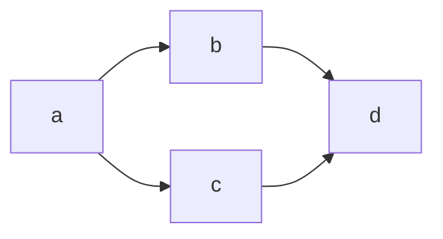

# Roadmap: {{PLAN_TITLE}}

> Source: [{{BASE_NAME}}.md](./{{BASE_NAME}}.md)
> Generated: {{ISO8601_UTC}}
> Parts: {{N}}

## Overview

{{OVERVIEW_2_3_SENTENCES}}

## Dependency graph

| Stage | Title | Depends on | Parallel group | Weight |
|-------|-------|------------|----------------|--------|
| a | {{TITLE_A}} | — | A | 🔴 heavy |
| b | {{TITLE_B}} | a | B | 🟡 medium |
| c | {{TITLE_C}} | a | B | 🟢 light |
| d | {{TITLE_D}} | b, c | C | 🟡 medium |

### Parallel groups

- **Group A** (blocking): a — runs first, blocks the rest.
- **Group B** (parallel): b, c — can run concurrently after group A.
- **Group C**: d — runs only after group B completes.

### Visualization (Mermaid)

## Stages

### a: {{TITLE_A}}
- **File**: [{{BASE_NAME}}-a.md](./{{BASE_NAME}}-a.md)
- **Depends on**: —
- **Blocks**: b, c
- **Weight**: 🔴 heavy
- **Summary**: {{SHORT_A}}

### b: {{TITLE_B}}
- **File**: [{{BASE_NAME}}-b.md](./{{BASE_NAME}}-b.md)
- **Depends on**: a
- **Blocks**: d
- **Weight**: 🟡 medium
- **Summary**: {{SHORT_B}}

### c: {{TITLE_C}}
- **File**: [{{BASE_NAME}}-c.md](./{{BASE_NAME}}-c.md)
- **Depends on**: a
- **Blocks**: d
- **Weight**: 🟢 light
- **Summary**: {{SHORT_C}}

### d: {{TITLE_D}}
- **File**: [{{BASE_NAME}}-d.md](./{{BASE_NAME}}-d.md)
- **Depends on**: b, c
- **Blocks**: —
- **Weight**: 🟡 medium
- **Summary**: {{SHORT_D}}
