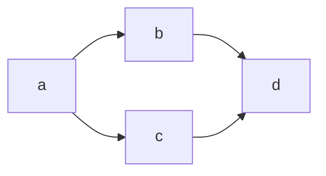

# Roadmap: {{PLAN_TITLE}}

> Источник: [{{BASE_NAME}}.md](./{{BASE_NAME}}.md)
> Сгенерировано: {{ISO8601_UTC}}
> Частей: {{N}}

## Обзор

{{OVERVIEW_2_3_SENTENCES}}

## Граф зависимостей

| Стадия | Название | Зависит от | Параллельная группа | Вес |
|--------|----------|------------|---------------------|-----|
| a | {{TITLE_A}} | — | A | 🔴 heavy |
| b | {{TITLE_B}} | a | B | 🟡 medium |
| c | {{TITLE_C}} | a | B | 🟢 light |
| d | {{TITLE_D}} | b, c | C | 🟡 medium |

### Параллельные группы

- **Группа A** (блокирующая): a — выполняется первой, блокирует остальные.
- **Группа B** (параллельная): b, c — можно выполнять одновременно после группы A.
- **Группа C**: d — только после завершения группы B.

### Визуализация (Mermaid)

## Стадии

### a: {{TITLE_A}}
- **Файл**: [{{BASE_NAME}}-a.md](./{{BASE_NAME}}-a.md)
- **Зависит от**: —
- **Блокирует**: b, c
- **Вес**: 🔴 heavy
- **Краткое содержание**: {{SHORT_A}}

### b: {{TITLE_B}}
- **Файл**: [{{BASE_NAME}}-b.md](./{{BASE_NAME}}-b.md)
- **Зависит от**: a
- **Блокирует**: d
- **Вес**: 🟡 medium
- **Краткое содержание**: {{SHORT_B}}

### c: {{TITLE_C}}
- **Файл**: [{{BASE_NAME}}-c.md](./{{BASE_NAME}}-c.md)
- **Зависит от**: a
- **Блокирует**: d
- **Вес**: 🟢 light
- **Краткое содержание**: {{SHORT_C}}

### d: {{TITLE_D}}
- **Файл**: [{{BASE_NAME}}-d.md](./{{BASE_NAME}}-d.md)
- **Зависит от**: b, c
- **Блокирует**: —
- **Вес**: 🟡 medium
- **Краткое содержание**: {{SHORT_D}}
