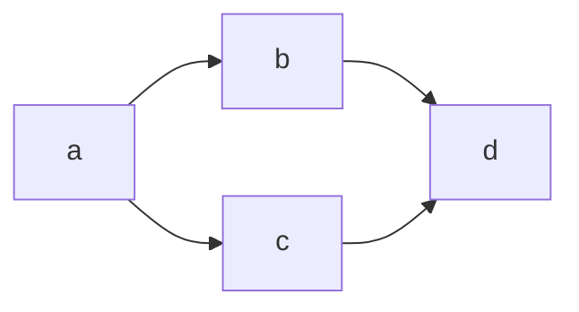

# Roadmap Format

## 1. File name

`<BASE>-roadmap.md`, next to the source plan.

## 2. Required sections

1. `# Roadmap: <plan title>`
2. A blockquote header: `Source`, `Generated` (ISO-8601 UTC), `Parts: N`.
3. `## Overview` (`## Обзор`): 2–3 sentences.
4. `## Dependency graph` (`## Граф зависимостей`): the table, the parallel groups, a Mermaid block.
5. `## Stages` (`## Стадии`): one block per part with a link to its file.

## 3. Dependency table

Columns, in this order:

| Stage | Title | Depends on | Parallel group | Weight |

- **Stage**: the part id, lowercase letters (`a`, `b`, … `aa`). This is the machine-readable
  contract: `plan-executor`, `plan-resolver` and `plan-iterative-revision` parse this column.
- **Title**: 1–4 words.
- **Depends on**: `—` or a comma-separated list of ids (`a, b`).
- **Parallel group**: a capital letter (`A`, `B`, …); a lone part still gets its own group.
- **Weight**: `🔴 heavy` / `🟡 medium` / `🟢 light`. Required; `plan-executor` derives the gate
  depth from it. Heavy: more than 10 tasks, or risky work (migrations, security, auth,
  concurrency, cross-module refactoring). Medium: 6–10 tasks, or a new integration. Light: up to
  5 tasks of local, low-risk work.

Validators lower-case ids and accept space-separated dependencies, but the generated file uses
the canonical form above. Any id that is not letters is an error.

## 4. Parallel groups

- Group `A` comes first: parts with no dependencies (or the same dependencies).
- Groups follow topological order: A → B → C …
- Parts in one group must not depend on each other (`validate-all` checks this).
- Parts are parallel when they do not touch the same files, neither consumes the other's result,
  and they need no coordination (e.g. both changing one DB schema).
- Part Y depends on X when Y uses, extends or relies on decisions of X.

## 5. Mermaid diagram

Required inside `## Dependency graph`; `validate-roadmap` / `validate-all` check that a
```` ```mermaid ```` block exists and has at least one edge (`-->`).



`LR` preferred; `TB` for long graphs. Every edge corresponds to a `Depends on` entry and vice
versa. No cycles (`validate-all` checks).

## 6. Stages section

One block per part:

```markdown
### a: <Title>
- **File**: [<BASE>-a.md](./<BASE>-a.md)
- **Depends on**: <ids or —>
- **Blocks**: <ids or —>
- **Weight**: <🔴/🟡/🟢>
- **Summary**: <1–2 sentences>
```

The `File` link must point to an existing part file (`validate-all` checks).
